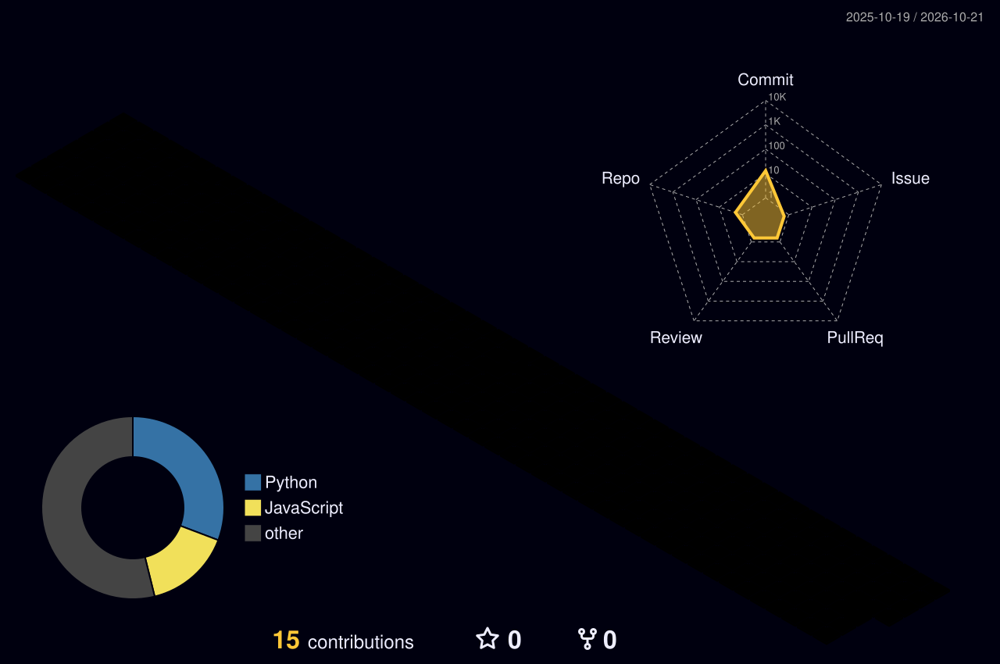

# Hey, I'm Mahaboob! 👋

### 🎓 MS Computer Science | Wright State University 🇺🇸

  

---

### 👨‍💻 A Little About Me

I'm a Computer Science graduate student at **Wright State University**, originally from Nepal 🇳🇵.

I love turning ideas into working applications, solving problems, and exploring how technology can make everyday tasks easier.

- 🔭 Building **Zenventory**, a voice-integrated inventory system
- 🧠 Interested in **Software Engineering & Data Science**
- 🌱 Exploring **Full-Stack Development and Python**
- 🎯 Open to **Software Development opportunities**
- ⚡ My mindset: **Learn. Build. Improve. Repeat.**

---

### ⚡ My Tech Stack

 

**SQL • React • Python • JavaScript • Node.js**

---

### 🚀 Featured Project

#### 🎙️ Zenventory — Voice-Integrated Inventory Management

**What if managing inventory was as simple as speaking?**

Zenventory explores voice-command integration in an inventory management system, bringing together frontend, backend, and database technologies.

**Tech:** `React` `JavaScript` `Python` `Node.js` `MongoDB` `SQL`

---

### 📊 GitHub Analytics

---

### 🐍 My Contribution Journey

---

### 🌌 My Coding Journey in 3D

---

### 💡 Curious Mind. Developer Mindset. Always Learning.

*Turning coffee ☕ and curiosity into code.*

**Thanks for visiting! Let's connect and build something meaningful. 🚀**

